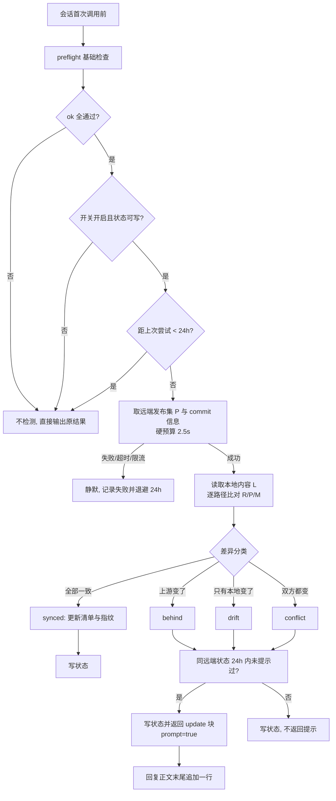
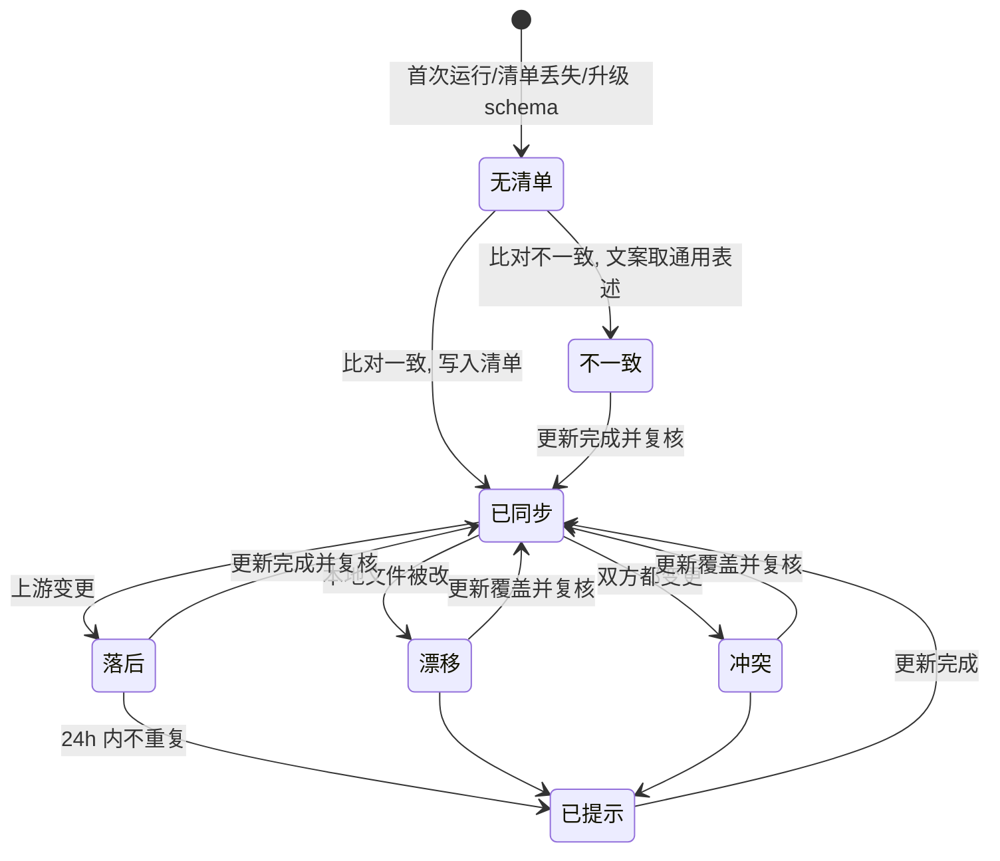
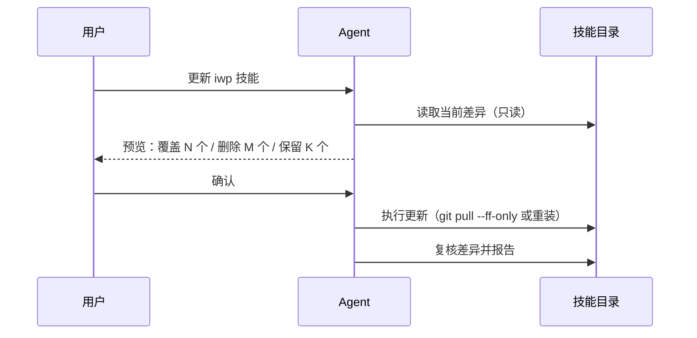

# 技能更新检测：发布集指纹（PSF）增量方案

状态：已确认（阶段二确认通过）；已实现（阶段三完成，待阶段四验收）
日期：2026-11-10
适用：iwp-skill 1.3.x → 1.4.0 的更新检测能力增量
文档角色：历史增量方案（新建），不覆盖 `docs/技能自动更新检测-方案设计.md`

## 1. 背景

1.3.0 的自动更新检测在 git 形态下工作正常，但在 zip 覆盖与 npx 安装形态下会**周期性误报"有更新"**。

实测证据（2026-11-10）：

| 事实 | 证据 |
|---|---|
| 本机经 npx 安装的副本被判定为落后 | 会话 7f49 的 assistant 回复末尾出现"检测到 iwp 技能有更新（2d38f11）" |
| 该副本内容与远端 2d38f11 的 45 个文件逐字节相同 | GitHub tree API 复核 45/45 一致 |
| 官方 CLI 同样报更新 | `npx skills check` 返回 `iwp has an update`，退出码 1 |
| 判定错位 | 现有实现取 lock 的 `skillFolderHash` 与远端 **commit sha** 等值比较；而 skills CLI v3 的定义是**技能目录 tree SHA** |
| 本机 lock 值异常 | `skillFolderHash` 恰等于 commit sha（2026-10-21 写入），与 tree sha 语义不符 |

结论：**把"commit sha"当成"内容身份"是误报根因**。commit 每次提交都变，tree 只在内容变时变，文件字节才是最终事实。

## 2. 目标与非目标

### 2.1 目标

1. 更新判定只依赖一个事实源：**远端发布集与本地内容的逐路径比对**；不再使用 commit sha 等值比较。
2. 覆盖三类真实安装形态：git clone/符号链接、zip/目录复制、npx 从 GitHub 安装。
3. 与远端"不一致"即提示，并区分成因（落后 / 本地漂移 / 双方冲突），避免把"用户改过"误报成"有新版本"。
4. 更新动作永不静默覆盖本地改动：执行前必须给出将被覆盖/删除的路径预览。
5. `.env.example` 不再出现真实公网入口；提供 git 历史清洗的运行手册（一次性运维动作）。

### 2.2 非目标

1. 不实现 skills.sh Pack（well-known 摘要）形态判定。
2. 不实现自动更新（仍由用户确认后触发既有更新流程）。
3. 不改动 `ok` / `checks` / `hints` / 退出码的既有口径。
4. 不做版本号比对（理由见 §4.9）。

## 3. 术语

| 术语 | 定义 |
|---|---|
| 发布集（Publish Set） | 远端仓库中该技能目录（`skillPath`，默认仓库根）下**被 git 跟踪**的路径集合，记为 `P` |
| 同步清单（Sync Manifest） | 最近一次确认"本地与远端一致"时，`P` 中每个路径对应的 blob 标识，记为 `M` |
| blob 标识 | Git blob 的 sha1：`sha1("blob " + len(bytes) + "\0" + bytes)`，40 位十六进制 |
| 发布集指纹（PSF） | 对整份发布集做路径绑定的规范化摘要，见 §4.2；用于快速比较与状态记录 |
| 漂移（drift） | 本地内容与同步清单、远端都不一致，即本地文件被改过 |
| 冲突（conflict） | 本地改过，远端同时也变过 |

## 4. 逻辑方案

### 4.1 发布集如何确定

- 远端一次 tree API 递归取整仓目录树（`truncated` 必须为 false），再取技能目录对应的子树，得到 `path → blob sha` 映射，这就是 `P`。
- 只取 git 跟踪的文件，因此 `.gitignore` 覆盖的运行时产物天然不在集合内：`.env`、`.token_key`、`.token_cache.enc`、`.swagger_meta.enc`、`.oauth_next_step.json`、`.callback_result.json`、`.update_state.json`、`__pycache__/`、`.mnemon/`。
- 单文件超过 4MB 的条目从集合中剔除（二进制资产不参与指纹），并在诊断输出中注明剔除数量。

### 4.2 指纹（PSF）如何计算

```
PSF(P) = sha256( 按路径字节序排序后，逐项写入：
                 len(path) ‖ path ‖ len(blob_sha) ‖ blob_sha )
```

- 路径参与编码：同名内容换位置也算不同，否则"重命名"会被误判为无变化。
- 使用长度前缀而不是分隔符，避免路径/字节中含分隔符造成拼接歧义。
- 指纹只用于"是否一致"的快速判断与状态记录；**提示文案与更新预览使用逐路径差异**，而不是指纹差异。

### 4.3 本地内容如何读取

两种安装形态，读取方式不同，但产出同一张 `path → blob sha` 表：

| 形态 | 判定依据 | 读取方式 |
|---|---|---|
| git（`.git` 存在） | 工作区文件 | 对 `P` 中每个路径执行 `git hash-object <path>`（应用 clean filter，使 Windows 的 CRLF 归一为 LF，与远端 blob 同口径） |
| 非 git（zip/复制） | 工作区文件字节 | 直接对文件字节计算 blob 标识 |

- **必须读工作区，不能读 index**：读 index 只能发现"已暂存"的改动，用户或 harness 改了文件但没 `git add` 时会被漏掉，正是本方案要抓的漂移。
- 文件缺失 → 记为该路径不存在；读取失败（权限/编码）→ 该路径记"未知"，整体降级为"无证据"，不产生提示。

### 4.4 差异分类

对 `P` 中每个路径 `p`，比较三份内容：本地 `L(p)`、远端 `R(p)`、同步清单 `M(p)`：

| 情形 | 判定 | 说明 |
|---|---|---|
| `L == R` | 一致 | 该路径无需动作 |
| `L == M` 且 `R != M` | `behind` | 上游改过（含上游删除、新增） |
| `L != M` 且 `R == M` | `drift` | 只有本地变了 |
| `L != M` 且 `R != M` 且 `L != R` | `conflict` | 双方都变了 |
| 无 `M`（首次运行或清单丢失） | `unknown` | 只能判"与远端不一致"，文案取通用表述 |

- 上游删除：`p ∈ M` 但 `p ∉ P`，若本地仍存在且 `L == M` → `behind`；若本地已不存在 → 一致。
- 本地多出的路径（`p ∉ P` 且 `p ∉ M`）→ 忽略（运行时产物、缓存）。
- 重命名等价于"删除 + 新增"，两条路径分别落入 `behind`，无需专门处理。

### 4.5 三态与提示

| 状态 | 条件 | `available` | `prompt` | 文案要点 |
|---|---|---|---|---|
| `synced` | 全部路径一致，且清单无遗留 | false | false | 无提示 |
| `behind` | 存在 `behind` 路径 | true | true | 有新版本（commit 短 sha + 日期） |
| `drift` | 存在 `drift`，无 `behind`/`conflict` | true | true | 本地 N 个文件与远端不一致，更新将覆盖 |
| `conflict` | 同时存在两类 | true | true | 上游有更新且本地有修改，更新将覆盖本地版本 |

- 提示仍只出现一次：同一远端状态 24 小时内不重复提示；远端状态变化可再次提示。
- `drift`/`conflict` 的提示措辞必须包含"覆盖"二字，避免用户误以为是纯增量。
- 诊断命令（只读）额外输出各分类的路径列表（每类最多 10 条 + 总数），供排查。

### 4.6 状态文件

- 版本：`schema` 由 1 升为 2；读到时旧版本一律视为不存在，下次探测自愈。
- 新增字段：同步清单 `manifest`（`path → blob sha`，仅记录上次一致时的快照）、`psf`（当时指纹）、`remote_sha`（当时远端 commit，仅用于文案展示）。
- 清单规模控制：路径数上限 2000、序列化上限 512KB；超限则只记 `psf` 不记清单，此时下一轮基于指纹判断"是否一致"，无法区分 `behind`/`drift`（降级为 `unknown` 文案），但不影响正确性。
- 写入仍为原子写；写失败 → 不输出 `update` 块。

### 4.7 判定流程



### 4.8 状态生命周期



### 4.9 为什么不用版本号兜底

版本号有三个硬伤，任何一个都会让"是否更新"的判断失效：

1. **可跳过**：本仓库已有两次内容变更未 bump 版本，版本相同但内容不同。
2. **不可比**：npx 安装看 registry version，git 安装看工作区内容，zip 安装看解压字节，三者不一致时版本号无法裁决。
3. **自身多口径**：`SKILL.md` 的 `metadata.version` 与 `skill_config.py` 的 `CLIENT_VERSION` 是两个用途，不能合并成升级信号。

因此版本号只保留为人类可读信息（提示文案里展示），不参与判定；无内容证据时保持沉默，不降级到弱判据。

### 4.10 更新动作的边界

检测器只读。更新仍由用户主动触发，执行前必须展示预览：



- git 形态优先 `git pull --ff-only`；失败时**不自动** `reset --hard`，而是给出"先 stash 或丢弃本地改动"两个选项由用户选择。
- 非 git 形态重装时，被覆盖的本地改动路径必须在预览中逐条列出。
- `.env` 等运行时产物不在发布集内，任何更新动作都不会触碰。

### 4.11 `.env.example` 去具体化

- `MCP_PUBLIC_BASE_URL` 改为占位符 `https://<iwp-host>`，README 与 `references/` 说明"地址向管理员索取"。
- 其余键保持现状（`IWP_CLIENT_ID` 是公开客户端标识，`IWP_REDIRECT_URI` 是 localhost 回调，均非机密）。
- 该文件属于发布集，改动会让所有安装形态首次比对时收到一次"内容不一致"提示——这是内容变更的必然结果，不是误报。

### 4.12 历史清洗运行手册（一次性运维）

前提：仓库仅作者维护、0 fork（已核实）。步骤：

1. 备份：`git bundle create ../iwp-skill-backup.bundle --all`，记录旧 HEAD。
2. 改写：`git filter-repo --replace-text replacements.txt`，将真实地址替换为占位符（仅作用于 `.env.example` 的历史 blob）。
3. 推送：`git push --force-with-lease`。
4. 本地对齐：`git reset --hard origin/main`。
5. 验收：`git log --all -S "<真实地址>"` 返回空；`git fsck` 无错误；工作区 clean。
6. 回滚：`git bundle unbundle` 或从备份克隆恢复。

已知残留：GitHub 侧旧对象缓存可能仍可直链访问（需联系支持清理）；第三方索引/镜像无法保证；任何已存在的、按旧 sha 的引用失效。

## 5. 规则

| 编号 | 规则 |
|---|---|
| R1 | 判定只使用"远端发布集 vs 本地内容"这一事实源；不再使用 commit sha 等值比较 |
| R2 | 本地内容必须读工作区，不得只读 git index |
| R3 | git 形态必须用 `git hash-object`（应用 clean filter）哈希，保证 CRLF 与远端 blob 同口径 |
| R4 | 只比较发布集内路径；本地多出的路径一律忽略，不维护排除清单 |
| R5 | 首次运行无清单时不得判"已同步"，文案取通用表述 |
| R6 | `drift`/`conflict` 必须提示，文案必须含"覆盖"语义；不得静默 |
| R7 | 绝不自动覆盖本地改动；更新前必须预览将被覆盖/删除的路径 |
| R8 | 24h 门禁与"同远端状态不重复提示"闸门保持现状语义 |
| R9 | 远端失败（超时/限流/坏响应）一律静默并退避 24h；失败也写状态 |
| R10 | `ok`/`checks`/`hints`/退出码口径完全不变；`update` 块只在真正探测时出现 |
| R11 | 状态 schema 升级后，旧状态视为不存在；写失败则不输出 `update` 块 |
| R12 | 4MB 以上文件从发布集剔除并在诊断中注明；路径数超过 2000 时只记指纹不记清单，判定降级为 `unknown` 文案 |
| R13 | 符号链接安装先解析真实目录再判定；子目录技能以 `skillPath` 子树为发布集 |
| R14 | 版本号不参与判定，仅用于文案展示 |
| R15 | 技能运行文件（含 `scripts/`）不得写入任何真实资产地址或凭证 |
| R16 | 历史清洗只能作为显式运维步骤执行，必须备份并验收 `git log -S` 为空 |

## 6. 效率模型

| 环节 | 实测/估算 | 频率 |
|---|---|---|
| tree API（整仓递归） | 12.4KB / 1.1s | 每天首次 |
| 本地哈希（45 文件 / 325KB） | 8ms | 每天首次 |
| git 形态本地命令 | 3 次 subprocess，<50ms | 每天首次 |
| 命中 24h 门禁 | 0 网络、<1ms | 其余所有会话 |

硬预算：整体 2.5 秒内完成（远端探测硬截止 2.5s），失败不重试。

## 7. 兼容性与风险

| 风险 | 影响 | 处理 |
|---|---|---|
| 远端 API 限流（匿名 60 次/小时） | 无法探测 | 静默退避 24h；诊断命令显示 `last_error` |
| 私有仓库 | tree API 404 | 静默；不再误报 |
| 浅克隆 | `git hash-object` 不依赖历史，可正常工作 | — |
| 符号链接 | 路径解析错误会读错目录 | 先解析真实路径 |
| CRLF / 编码 | 误判为漂移 | 走 clean filter（R3） |
| 大文件/大目录 | 请求过大 | R12 降级 |
| 清单过期 | 一次误判 | 下次一致即刷新 |
| 历史改写 | 旧 sha 引用失效、安装副本需对齐 | 仅作者维护、0 fork，可接受；按 §4.12 验收 |

## 8. 验证方案

| 编号 | 场景 | 期望 |
|---|---|---|
| A1 | git 形态，远端无新提交 | `synced`，`update` 块 `available:false`，无提示 |
| A2 | git 形态，远端新增提交 | `behind`，提示一次；24h 内不重复 |
| A3 | 本地手改一个发布集文件（未提交） | `drift`，提示含"覆盖"，预览列出该路径 |
| A4 | 本地改文件且远端也改同一文件 | `conflict`，提示含"覆盖" |
| A5 | 上游删除一个本地仍存在的文件 | `behind`，预览含"将删除" |
| A6 | zip 副本与远端逐字节一致 | `synced`，**不再误报**（当前误报场景的回归用例） |
| A7 | npx 安装（lock 存在、树一致） | `synced`，`form:cli` |
| A8 | 首次运行（无状态） | `unknown` 文案，之后写入清单 |
| A9 | 状态文件损坏 / schema=1 | 视为不存在，正常探测 |
| A10 | 缺 `.env`（preflight 失败） | 不探测、不写状态、退出码 1 不变 |
| A11 | 远端超时 / 403 / 坏 JSON | 静默，`last_error` 有值，不提示 |
| A12 | 空白安装（无 `.git`、无 lock） | `no_evidence`，静默 |
| A13 | CRLF 工作区 + autocrlf | 与远端一致，不判漂移 |
| A14 | 上述全部 | 单测 100% 离线、`ok`/退出码与 `preflight` 基线逐字段一致 |

## 9. 文档角色与同步

- 本文档为**历史增量方案**，新建，不改写既有的 `docs/技能自动更新检测-方案设计.md`（记录 1.3.0 的设计与验收）。
- 实现落地并经阶段四验收后，再把结论追加到 `docs/architecture.md` 的 ADR 体系，并把本文档状态改为"已实现"。
- 本阶段不调用 `frontend-design`：本次为 CLI 与状态机层面的逻辑变更，无页面、无布局、无视觉方向。

## 10. 确认项

1. 是否认可本方案（PSF 单一判据 + 三态提示 + 更新预览 + `.env.example` 占位符 + 历史清洗手册）。
2. 是否保留本文档（保留则去掉 `待确认-` 前缀并入版本库；不保留则仅在阶段三期间留盘）。
3. 是否需要维护统一方案文档（本轮默认不动 `docs/architecture.md`，实现验收后再追加 ADR）。
4. 是否进入阶段三执行。

## 13. 实现落地（阶段三）

| 方案项 | 落地位置 | 说明 |
|--------|---------|------|
| 发布集 P（§4.1） | `scripts/update_check.py` `parse_tree` | 一次 `git/trees/{sha}?recursive=1`；要求 `truncated is false`；仅取 `type=blob` 且 `mode ∈ {100644,100755}`；目录、符号链接（120000）、子模块（160000）与单文件 >4MB 一律跳过并计入 `excluded` |
| PSF（§4.2） | `psf()` / `blob_sha()` | `blob_sha = sha1("blob <len>\0" + bytes)`；PSF 按路径 UTF-8 字节序写入 4 字节大端 `len(path)‖path‖len(hex)‖hex`，`hex` 为 40 字符十六进制 |
| 本地读取（§4.3） | `_git_manifest` / `_raw_manifest` | git 形态 `git hash-object --stdin-paths`（每批 200 条，走 clean filter）；非 git 形态读字节复算，原始字节不等时再按 CRLF→LF 复算一次（R3 扩展，避免 Windows 检出打包造成全量假差异） |
| 差异分类（§4.4） | `classify()` | 输出 `status` + `detail{modified,missing,stale,extra}`；`stale` 覆盖「上游删除」场景 |
| 三态与提示（§4.5） | `_maybe_check()` / `prompt_allowed()` | `behind`/`drift`/`conflict` 均 `available=true`；闸门键为 `<remote_sha>:<status>`，24h 内不重复 |
| 状态文件（§4.6） | `read_state` / `write_state` / `STATE_KEYS` | schema 2；原子写（mkstemp + `os.replace`）；**manifest/psf 只在 `synced` 时更新为远端快照**，否则保留旧值（否则「本地仍是旧版」下一轮会被误判 `drift`） |
| 判定流程（§4.7） | `maybe_check` → `_maybe_check` | 开关 → 门禁 → 可写性 → 身份 → 探测 → 本地清单 → 分类 → 写状态 → 返回块；任何异常不外抛 |
| 更新动作（§4.10） | `references/_shared/update-flow.md` | 提示只告知；用户要求更新时走既有 Step 0–3，覆盖本地改动前必须出完整预览 |
| 去具体化（§4.11） | `.env.example:5-7` | `MCP_PUBLIC_BASE_URL=https://<iwp-host>` |
| 失败退避（R9） | `check_due()` / `FAIL_RETRY_S` / `RateLimited` | 网络失败 15 分钟重试；403/429 按 `x-ratelimit-reset`（缺失用 `Retry-After`，再兜底 1h）；`retry_at` 到期后不受 24h 窗口约束 |
| 诊断入口（§4.9） | `diagnose()` / `python scripts/update_check.py` | 只读，不写状态、不改闸门；输出 `diff` 每类前 10 条 |

**与方案的偏差（阶段三记录）**

1. `PROBE_BUDGET_S` 由 2.5s 调到 5.0s、`HTTP_TIMEOUT_S` 调到 3.0s：实测单次 commit 请求 0.8–2.8s（偶发握手 >2.5s），2.5s 预算会稳定失败。
2. 新增「失败重试 15 分钟」与「配额耗尽按 header 退避」：方案原写「失败也 24h 退避」，实测一次网络抖动就会让检测静默一天。
3. 非 git 形态新增 CRLF 容错复算（方案只写了 git 形态用 clean filter）。
4. `manifest/psf` 的写入条件收紧为「仅 synced」，方案 §4.6 原文只写「仅记录上次一致时的快照」，实现中发现不收紧会产生 `behind`→`drift` 误判。
5. 预算二次放宽为 `HTTP_TIMEOUT_S=15.0s`、`PROBE_BUDGET_S=30.0s`（v1.4.1，取代第 1 条的 3.0s/5.0s）：实测该链路 `/commits/main` 2.8–5.5s、`/git/trees/{sha}` 5.7–9.7s，合计 9–13s；4s 预算下探测**必然**判超时并退避 15 分钟，表现为「上游确有更新但会话里从不提示」。放宽后代价是每会话首次调用最坏多等 30s（24h 门禁 + 失败 15 分钟退避限制频次）。备选方案「后台异步探测（本次会话不提示、下次再提示）」已评估暂不采用。
