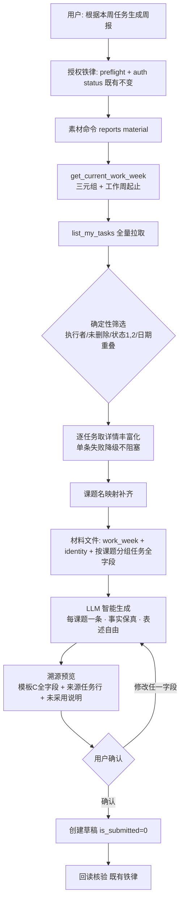
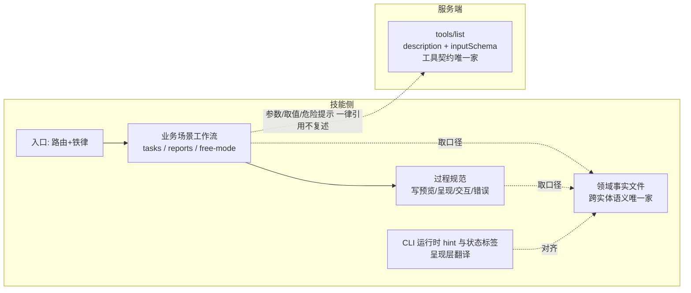

# 周报智能生成与提示词约束强化 - 方案设计

> 状态：**正式**（用户已确认，2026-10-27）
> 日期：2026-10-27
> 上游输入：阶段一需求分析（已确认），含 InnovationWorkPlatform 后端 `/tasks/weekly-draft` 权威逻辑核实结论

## 术语表

| 术语 | 定义 |
|------|------|
| 素材命令 | 技能 CLI 新增子命令 `reports material`：确定性筛选本周任务并输出全字段原始材料，供 LLM 生成周报 |
| 生成契约 | 周报场景参考文件中约束 LLM 生成行为的规则集：粒度、事实保真、溯源、完成判据 |
| 溯源行 | 周报创建预览中附加的「来源任务」清单行（task_id/标题/状态/进度），仅智能生成路径使用 |
| 呈现层翻译 | 面向用户显示的枚举中文化（如状态整数→中文标签），不承载契约语义，口径以权威表为准 |
| 周报三元组 | 创建周报必填的 work_week_id / user_id / org_id，来自 get_current_work_week 返回 |

## 1. 背景与目标

当前技能按课题任务生成周报（W2）存在结构性缺陷：唯一一处映射规则把课题名指定为 work_name 的合法取值，导致生成结果系统性错误；同时任务筛选、日期过滤靠 LLM 肉眼执行，不可靠。此外提示词体系存在领域语义无安身之所（散落三处且相互冲突：任务状态 3 在客户端渲染为「暂停」，服务端与后端源码均为「已取消」）、参考文件与服务端 description 双重复述、部分工具无场景覆盖三类问题。

本次目标：

1. 周报生成重构为「代码筛选 + LLM 智能生成 + 溯源预览」三层分工——机械逻辑只负责选出材料，周报文本由 LLM 智能总结；
2. 建立领域事实的唯一安身之所，消除双份维护与活冲突；
3. 按「MCP 为主」原则划定技能侧与服务端的知识边界；
4. 补全场景覆盖缝隙。

## 2. 真实现状（已核实）

- 后端权威逻辑（InnovationWorkPlatform `backend/app/api/tasks.py` `/tasks/weekly-draft`，Web 前端在用）按五条规则筛选任务：执行者分配未移除、未删除、状态∈{1进行中,2已完成}、`actual‖planned` 日期与工作周**重叠**、无日期任务**入选**；每课题聚合一条；其 work_name/content/result 为机械编号拼装——**仅借鉴其筛选逻辑，不借鉴拼装**。
- 任务状态权威口径（三处互证：models 注释、weekly-draft 状态映射、my-tasks 接口文档）：**0=待开始，1=进行中，2=已完成，3=已取消**；课题状态为另一枚举：0=储备中，1=进行中，2=已完成，3=暂停。技能 CLI 渲染的任务状态标签 3=「暂停」、0=「未开始」均与权威口径不符。
- 任务日志是审计流水（action_type：0-创建/1-更新/2-状态变更/3-分配/4-评论/5-上传附件/6-删除），后端机械草稿零使用；仅 action_type=4 评论含叙事内容。
- MCP 列表接口为投影返回（id/标题/状态/优先级/日期/执行人），**无描述、无进度**；全字段须逐任务取详情。
- MCP server 未暴露草稿类工具；server description 对 create_weekly_report 三字段（work_name/work_content/work_result）零语义说明。
- 技能侧现状：W2 映射规则错误；任务状态标签错误；领域语义散落（CLI 标签表、周报场景文件、任务场景文件、server description 四处）；触发话术/参数默认值/危险提示双重复述；get_task_children、list_work_weeks、delete_weekly_report 无场景覆盖。

## 3. 目标态（与现状的行为差异）

| 环节 | 现状 | 目标态 |
|------|------|--------|
| 选任务 | LLM 拉列表后肉眼比对日期过滤 | 素材命令一次性完成筛选+丰富化，输出材料文件 |
| 写周报 | 按错误映射规则机械拼装 | LLM 智能总结：每课题一条，表述自由、事实保真 |
| 防失真 | 「防止把未完成写成成果」一句告诫 | 生成契约四条保真规则 + 溯源行 + 双向覆盖判据 + 完整预览铁律 |
| 状态显示 | 3=暂停（错） | 3=已取消（对齐权威口径） |
| 领域语义 | 四处散落 | 共享参考目录新增领域事实文件，唯一安身之所 |
| 参数语义 | 技能侧与服务端双份 | MCP 为主：server 已承载的一律引用不复述 |

## 4. 逻辑设计

### 4.1 分层架构

知识分层（提示词体系）：

### 4.2 筛选层：素材命令逻辑规则

**输入**：工作周（缺省当前周；可指定历史工作周 ID 用于补写场景）。

**筛选规则（确定性，全部对齐后端权威逻辑，代码执行）**：

1. 我作为执行者且分配关系未移除；
2. 任务未删除；
3. 状态 ∈ {进行中, 已完成}（待开始、已取消不进材料，固定口径不暴露参数——保持行为可预期）；
4. 日期重叠入选：实际起止缺省回退计划起止；结束日 ≥ 周开始 且 开始日 ≤ 周结束；
5. 起止日期全缺的任务视为入选（与后端一致）。

**丰富化**：筛选命中后逐任务取详情补全投影缺失字段（描述、进度等）；单条详情失败不阻塞，该任务降级为「仅投影字段 + 错误标注」；课题名优先取详情返回中的课题信息，缺失时经课题列表接口批量映射补齐（以联调核实详情返回形状为准）。

**输出契约**（单一材料文件，遵循既有 ASCII-safe stdout / `--out` UTF-8 文件约定）：工作周信息 + 身份三元组 + 按课题分组的任务全字段列表（含呈现层状态标签）+ 计数摘要。空选入时输出空分组与计数 0——「本周无任务如实说明」的既有边界由该结果自然触发。

**边界**：未授权/服务异常走既有错误契约与翻译表，不新增错误类别。

### 4.3 生成层：W2 提示词契约

周报场景参考文件的「根据课题任务生成周报」子工作流重写为四步：

1. **取材料**：运行素材命令（一次调用同时拿到三元组与筛选后任务材料，不再单独调工作周接口）；
2. **智能生成**：按课题聚合，每课题一条周报；work_name 由该课题本周任务名称组织、work_content 为所做工作的详细描述、work_result 为产出与进度。LLM 自主组织详略、措辞与聚合——**不是编号拼装，也不只是润色**；
3. **溯源预览**：每条周报区块 = 模板 C 全字段 + 溯源行；完成判据（双向可检验）：每条周报的来源任务可对应材料中真实任务 ID；材料中每条任务**要么被某条周报引用、要么在预览中给出未采用的说明**，不静默丢弃；
4. **确认创建**：既有完整预览确认铁律与回读核验不变，默认草稿，用户明确说提交才置提交。

**生成契约四条保真规则**（必须满足）：

- 任务名称、进度数字、完成状态与材料一致，不得改写数值；
- 进行中任务不得以完成语气表述；已完成任务不得写成进行中；
- 无描述的任务可基于材料其他字段概括，材料信息不足时询问用户，不得编造；
- 用户点名要求参考日志/评论时，仅取评论类（action_type=4）内容作为补充素材，变更流水不进周报（默认路径不调日志接口）。

**边界变化**：旧 W2 的「任务与周时间段不匹配 → 列出可疑项让用户取舍」规则删除——时间归属已由筛选层代码保证，提示词不再承担。

### 4.4 领域事实文件与「MCP 为主」去重

**新增共享参考文件（领域事实唯一家）**，只收 server description 放不下的**跨实体语义**：

- 实体层级：课题 → 任务（含父子层级）；课题 → 周报；工作周为独立时间维度；
- 状态枚举权威表：任务（0-3 含业务含义与英文枚举映射）、课题（0-3），标注来源与校准日期；
- 周报三字段内容语义契约（work_name=任务名称组织 / work_content=详细描述 / work_result=产出与进度）与三元组来源；
- 「本周的任务」归属规则：指向素材命令（代码为口径执行者）。

**明确不收录**（一律以 server description / inputSchema 为准，引用不复述）：单工具参数清单、必填性、枚举取值定义、默认值说明、危险提示。

**去重规则**（写入工具发现约定的反模式清单）：仅当 server description 已承载某语义时，技能参考文件不复述。保留项：确认政策（如「用户明确说提交才置提交」是技能侧门槛，保留；「0 是什么含义」是 server 语义，删）；write-preview 的 create_task 默认值呈现（server 未承载，预览呈现需要，保留）。

**状态标签处置**：CLI 状态标签修正为权威口径（0=待开始，3=已取消），定位为呈现层翻译——与写预览的「英文枚举中文化呈现」同类，不构成契约第二源；领域事实文件为口径引用者。

### 4.5 覆盖补全

各场景参考文件只补「何时用 + 指向」，不复制参数表（遵守 4.4 去重规则）：

- 任务场景查询工作流：补「任务拆了哪些子任务」场景（子任务查询工具；非执行者 404 属预期行为，语义见 server description）；
- 任务场景更新工作流：补一句「可改字段远不止状态（标题/描述/紧急度/进度/日期/里程碑/换父等），以 schema 为准」；
- 周报场景：补「补写历史周」入口（先列工作周拿 ID）；查询工作流补删除周报一行（高危且不可恢复，见写预览工具要点表）。

**使用案例集同步**：周报案例中「按课题聚合成若干条周报（每条 = 事项名 + …）」的机械拼装描述改为「筛选 → 智能生成 → 溯源预览」口径。

### 4.6 写预览规范扩展点

模板 C 增加溯源行扩展：智能生成路径的周报创建预览在模板 C 全字段基础上追加「来源任务」行与「未采用说明」；手动创建路径无溯源行。模板 C 原完成判据（覆盖 inputSchema 全部字段）不变，溯源行为附加行。

## 5. 规则与边界汇总

必须满足：筛选五条对齐后端；生成契约四条保真；溯源双向判据；状态标签修正；去重规则仅针对 server 已承载语义。
可选增强：素材命令输出中的附加统计字段；历史周补写入口的具体交互措辞。
明示不做：不做周报自动提交（维持默认草稿铁律）；不改 server 仓库；不引入扁平/层级机械拼装模式。

## 6. 风险与兼容性

| 风险 | 缓解 |
|------|------|
| LLM 生成失真（改数值/语气错位） | 生成契约四条 + 溯源行 + 完整预览确认铁律 + 回读核验，四重约束 |
| 任务详情返回是否含课题名未核实（server 当前不可达） | 设计含回退路径（课题列表批量映射）；联调时核实并确认实际触发分支 |
| N+1 详情调用耗时 | 每周任务典型 5~20 条，批间延隔沿用既有先例；失败降级不阻塞 |
| 旧材料习惯迁移（提示词改动后行为变化） | W2 是唯一变化入口，W1/W3 路径不动；案例文档同步新口径 |
| 状态标签修正影响既有输出阅读 | 仅两处枚举值语义变化（0、3），呈现层无结构变化 |

## 7. 验证方案

1. **筛选纯函数单测**：日期重叠五组边界（无日期入选 / 结束早于周开始剔除 / 开始晚于周结束剔除 / 跨周包含入选 / 周内包含入选）+ 状态过滤 + 空选入；
2. **素材命令契约验证**：输出形状断言（工作周/身份/分组/计数；单条详情失败的降级标注）；
3. **联调走查**（依赖 MCP server 恢复可达）：真实数据全流程（素材命令 → 详情课题名字段核实 → 生成 → 预览 → 创建草稿 → 回读）；
4. **提示词走查清单**：按生成契约四条与溯源双向判据逐条核对改写后的场景文件；用 writing-great-skills 口径复查（无操作句 / 重复语义 / 纯否定句式）；
5. **回归**：授权状态、体检、任务列表、写预览既有流程行为不变（改动仅新增子命令与标签数值）。

## 8. 附注

- 不调用 frontend-design 的原因：本次改动全部位于 CLI 输出契约与提示词文档层，无任何页面、布局、交互变更。
- 文档角色：新建活跃方案稿（本文件）；仓库内无统一现状方案文档；不覆盖任何历史增量方案。
