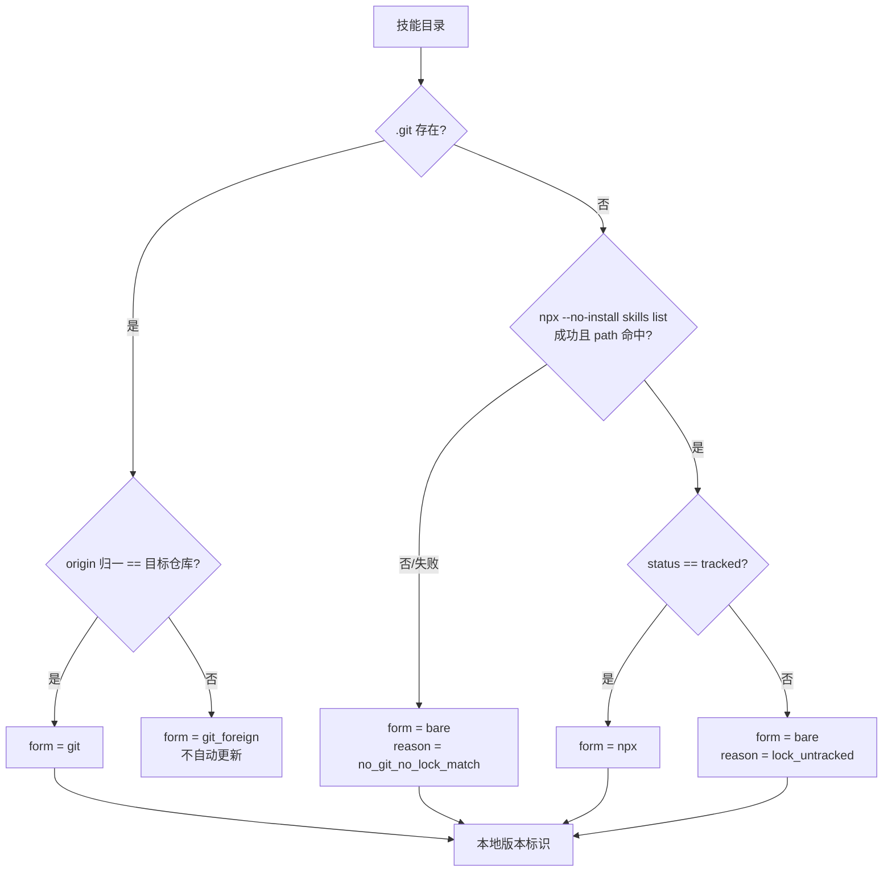
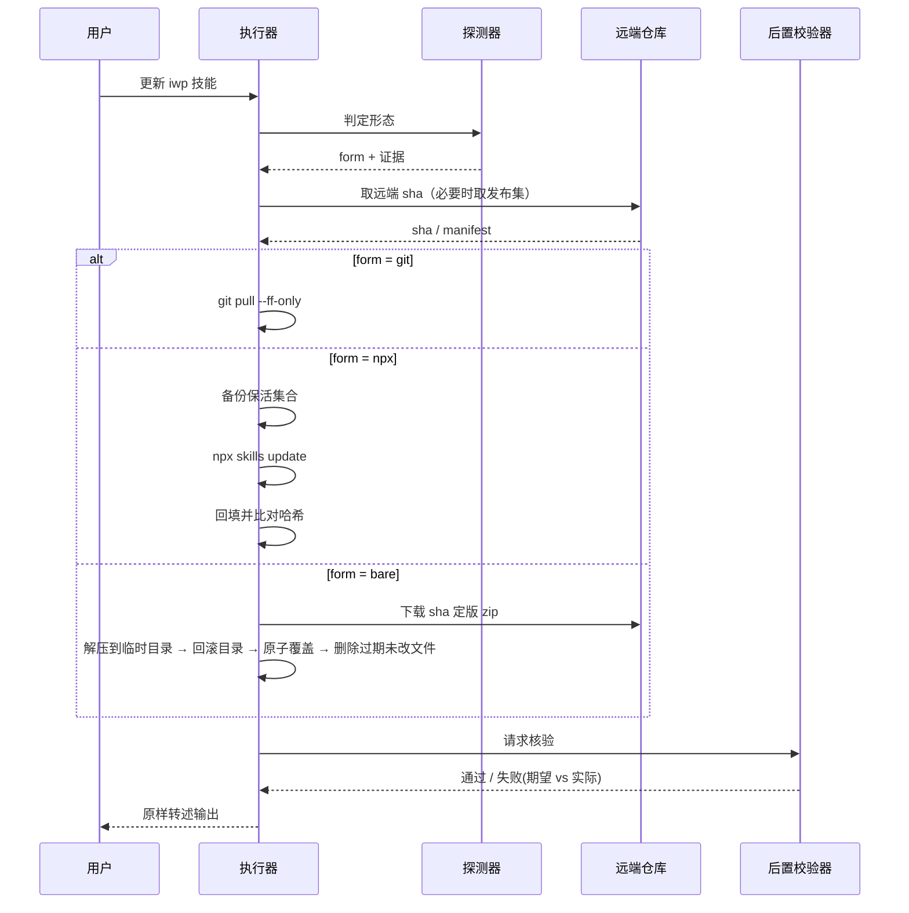
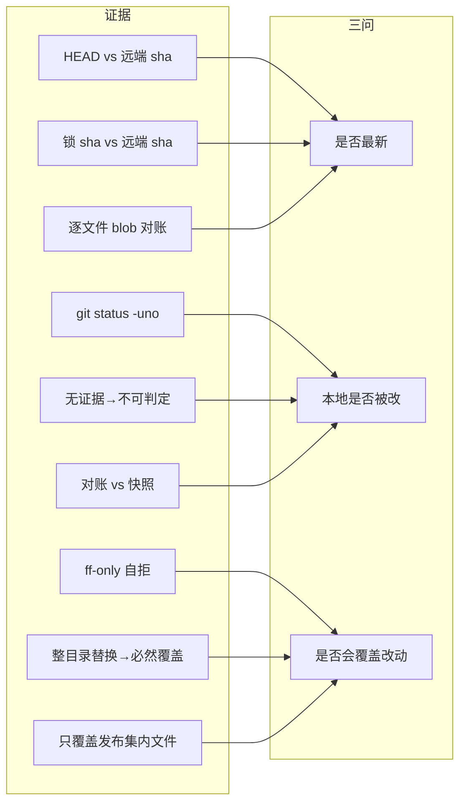

# 技能更新：三形态探测与统一更新 - 方案设计

状态：已实施（阶段三完成，2026-11-13；载体 `scripts/update_check.py` 与 `scripts/skill_update.py`）
日期：2026-11-13
关系：本文是增量方案。`docs/技能自动更新检测-方案设计.md`（2026-11-10）与
`docs/PSF技能更新指纹-方案设计.md`（2026-11-11）为历史方案，保留不动，本文不覆盖其结论。

## 0. 术语

| 术语 | 定义 |
|------|------|
| 安装形态（form） | 技能目录与上游仓库的绑定方式，取值 `git` / `npx` / `bare` / `git_foreign` |
| 发布集 | 上游仓库在某个 commit 下被 git 跟踪的全部普通文件（路径 → blob sha） |
| blob sha | git 内容标识，`sha1("blob <字节数>\0" + 内容)` |
| PSF | 发布集指纹：对发布集按路径字节序逐项哈希得到的摘要 |
| 快照 | 状态文件里记录的「上次本地与远端一致时」的三元组 `(远端 sha, 发布集, PSF)`，三者必须同源 |
| 状态文件 | 技能目录内被 `.gitignore` 列出、不进版本库、不进发布包，但属于用户资产的本地文件 |
| 保活集合 | 更新时必须原样存活的状态文件清单 |
| 后置校验 | 每次更新动作结束后，判定「本目录是否已等于远端最新」的独立核验 |

## 1. 设计目标与非目标

### 1.1 目标

1. 对 `git` / `npx` / `bare`（解压或手工拷贝）三种安装形态作出确定性判定，误判可被事后发现而非静默放过。
2. 三种形态各自使用与之匹配的检测证据，只保留一种形态（`bare`）继续使用发布集指纹 PSF。
3. 更新动作由程序按探测结果自行分派，使用者只执行一个命令；把「文档判据 + 人工判断」从关键路径上移除。
4. 任何一次更新结束后都有统一后置校验，失败必须显式报出期望值与实际值，不得以子进程退出码代替结果判定。
5. 状态文件在三种更新路径下一律存活，且保活清单只有一个来源。

### 1.2 非目标

1. 不改安装目录、不改客户端投放方式、不改 `SKILL.md` 路由与业务链路。
2. 不做状态外置（决策 2 已否决），不引入并发文件锁。
3. 不支持 Windows + pwsh 之外的平台（沿用现状，非 Windows 给出明确告知）。
4. 不引入第三方依赖（延续纯标准库约束）。
5. 不做国内镜像/代理方案，本轮只解决形态判定与更新正确性。

## 2. 真实现状（均已核对源码与本机环境）

### 2.1 形态判定只有两态，且用「无 .git」反推「npx」

`scripts/update_check.py:543-549`：

```python
def detect_form(skill_dir: Path | None = None) -> str:
    d = SKILL_DIR if skill_dir is None else skill_dir
    inside_git = (d / ".git").exists()
    return "git" if inside_git else "cli"
```

`D:\11349\.dsh\skills\iwp-skill-main` 是从 zip 解压的普通目录，无 `.git`，因此被判为
`cli`；`cli` 在 `action_for`（`scripts/update_check.py:332-334`）里直接映射到
`update_route`，而 `update_route` 的实际执行者是无条件调用 npx 的脚本。

### 2.2 锁文件的来源比对无法证明「这份副本归 npx 管」

`_lock_identity`（`scripts/update_check.py:595-610`）只比较 `entry.sourceUrl` 是否等于目标
仓库，不涉及当前技能目录。锁文件 `~/.agents/.skill-lock.json` 中 `iwp` 条目实际字段为
`source` / `sourceType` / `sourceUrl` / `skillPath` / `skillFolderHash` / `installedAt` /
`updatedAt`，没有任何安装路径字段，结构上无法回答「这条记录对应哪个目录」。

### 2.3 更新脚本不看目录，退出码即判据

`scripts/update.ps1:52` 无条件执行 `npx -y skills@latest update iwp -g -y`，未校验
`$skillDir` 是否是 npx 管理的目录；`:53` 以 `$LASTEXITCODE` 判定成功；`:62-79` 的哈希校验
只覆盖被备份的 4 个状态文件，从不校验技能内容。因此「命令成功、目录没变、脚本报
`[DONE]`」可以同时成立。

### 2.4 文档里的形态判据恒真

`references/_shared/update-flow.md:49` 判定「CLI 安装 = 技能目录含 `scripts/update.ps1`
且锁里有 `iwp`」。`update.ps1` 随仓库发布，任何形态解压后都含该文件，该条件对 `git`、
`npx`、`bare` 全部为真，第二行「含 `.git` 或符号链接」永远轮不到。

### 2.5 保活清单与 `.gitignore` 不一致（本轮新发现）

`scripts/update.ps1:23-31` 的 `$statePatterns` 只有 7 项：`.env`、`.token_key`、
`.token_cache.enc`、`.swagger_meta.enc`、`.oauth_next_step.json`、
`.oauth_next_step.json.bak`、`.callback_result.json`。
而 `.gitignore:2-12` 的凭证段有 11 项，多出 `.env.local`、`.env.server`、`.env.server1`、
`.env.server2`。当前技能根目录实际存在 `.env.local`、`.env.server1`、`.env.server2` 三个
文件（均为未跟踪文件）。`npx skills update` 是整目录替换，这三个文件会被删除且没有备份。

### 2.6 锁里的 `skillFolderHash` 对 GitHub 来源等于 commit sha（本机核实）

`~/.agents/.skill-lock.json` 的 `iwp.skillFolderHash` 为
`04317ff6314d413021f501a02531eefeca414e33`，与仓库 HEAD 完全相同。因此 `npx` 形态存在
一个可离线读取的版本标识。

### 2.7 npx 归属可以离线权威判定（本机核实）

`npx --no-install skills list -g --json` 在无网络条件下 exit 0，返回 41 条记录，每条含
`name` / `path` / `scope` / `agents` / `source` / `sourceUrl` / `sourceType` / `status`。
`iwp` 条目为 `path=C:\Users\11349\.agents\skills\iwp`、`status=tracked`、
`sourceUrl=https://github.com/TKOHP/iwp-skill.git`。
`D:\11349\.dsh\skills\` 下没有任何路径出现在该列表中。

### 2.8 目前不存在按形态执行的更新程序

`cli.py` 的子命令定义在 `:552-620`（`call` / `tools` / `selfcheck` / `auth` / `tasks` /
`reports`），没有 update。更新动作的实际承载者只有 `scripts/update.ps1`，它只认 npx 一条路。

### 2.9 既有缺陷与本文设计的对应关系

| 编号 | 现状缺陷 | 本方案消除方式 |
|------|----------|----------------|
| A | `detect_form` 两态、用「无 .git」反推 npx（§2.1） | §3.2 三态探测，npx 必须由 `skills list` 的路径匹配正面证明 |
| B | 锁来源比对不涉及目录（§2.2） | §3.2 以绝对路径匹配为唯一证据；锁只作版本标识，不作归属证据 |
| C | 更新脚本无条件 npx、退出码即判据（§2.3） | §3.5 由程序先探测再分派；§3.4 统一后置校验判成败 |
| D | 文档判据恒真（§2.4） | §3.8 文档不再承担形态判定，只描述「执行一个命令并转述输出」 |
| E | 保活清单漏 4 项（§2.5） | §3.6 保活集合由 `.gitignore` 派生，只此一处来源 |

## 3. 逻辑方案

### 3.1 组件与职责

| 组件 | 职责 | 不做什么 |
|------|------|----------|
| 探测器 | 判定安装形态，输出形态与其证据 | 不发起更新、不写技能内容 |
| 检测器 | 按形态取本地版本标识，回答「三问」，产出状态与是否提示 | 不执行更新 |
| 执行器 | 按形态分派更新，管理保活集合的备份/回填/回滚 | 不自行判定成功，交后置校验 |
| 后置校验器 | 独立核验更新后本目录是否等于远端最新 | 不重试、不修正 |
| 状态库 | 保存快照、门禁与提示闸门记录 | 不保存与形态无关的结论副本 |

形态判定与更新执行必须在同一程序内完成，且仅此一处。原先「文档判据决定走哪条命令」的
分工取消：文档只保留「执行一个入口命令、如实转述输出」。

### 3.2 形态探测

探测按固定顺序，一旦命中即停止；每一步都必须给出正面证据，不以「没有 A 的证据」推出「是 B」。

1. **git 判定**：技能目录含 `.git` 且 `git remote get-url origin` 归一后等于目标仓库
   `owner/repo` → 形态 `git`。
2. **git_foreign 判定**：含 `.git` 但 origin 不等于目标仓库（分叉、开发副本、改了远端）
   → 形态 `git_foreign`。此形态不自动更新，也不得按 `bare` 覆盖（会弄脏工作树）。
3. **npx 判定**：`npx --no-install skills list -g --json` 成功，且存在一条记录满足：
   `path` 与技能目录绝对路径相同（Windows 路径比较不区分大小写、分隔符归一）、
   `sourceUrl` 归一后等于目标仓库、`status` 为 `tracked` → 形态 `npx`。
4. **npx 降级判定**：`skills list` 成功且路径命中，但 `status` 不是 `tracked`（锁记录已丢
   或损坏）→ 按 `bare` 处理，并标记原因 `lock_untracked`。理由：此时 npx 无法按锁正确更新，
   而 `bare` 覆盖不会删除任何文件，是安全路径。
5. **bare 判定**：以上都不成立 → 形态 `bare`，原因记为 `no_git_no_lock_match`。

探测成本与前提：第 3 步依赖 Node 运行时与本地 npx 缓存，`--no-install` 保证不触发下载。
Node 不在 PATH 时第 3 步不成立，但此时该目录不可能是 npx 形态，判 `bare` 属于正确推理而非
猜测。探测结果只在一次检查内有效，不做跨轮缓存，避免「缓存了错误形态」再次变成静默错误。

### 3.3 本地版本标识与「三问」

检测只需回答三问：是否最新、本地是否被改、更新是否会覆盖本地改动。

| 形态 | 版本标识 | 本地是否被改 | 更新是否覆盖改动 |
|------|----------|--------------|------------------|
| git | `git rev-parse HEAD` | `git status --porcelain --untracked-files=no` 非空 | `git pull --ff-only` 自身会拒绝 |
| npx | 锁的 `skillFolderHash` | 无法判定（无内容证据） | 会，且整目录替换，必删状态文件 |
| bare | 无提交身份，只能逐文件对账（PSF） | 与快照逐文件比对 | 只覆盖发布集内的文件，未跟踪文件不动 |

状态语义按形态落地：

| 形态 | synced | behind | drift | conflict |
|------|--------|--------|-------|----------|
| git | HEAD == 远端 sha 且工作树干净 | HEAD != 远端 sha 且干净 | HEAD == 远端 sha 且工作树脏 | HEAD != 远端 sha 且工作树脏 |
| npx | 锁 sha == 远端 sha | 锁 sha != 远端 sha | 不产出（见 §6 风险 1） | 不产出 |
| bare | 逐文件全部一致且无残留 | 本地为旧版且未改动 | 上游未变、本地被改 | 双方都改 |

`bare` 形态的快照快捷判定：当状态库里的快照满足「`远端 sha` 与 `发布集` 同源」且该 sha 等于
本次探测到的远端 sha 时，无需再拉取远端发布集，本地逐文件比对结果即可直接定论（一致 →
`synced`，不一致 → `drift`）。这要求快照三元组 `(远端 sha, 发布集, PSF)` 同时写入、同时失效；
现状 `_maybe_check` 无论是否同步都会写 `remote_sha`，但只在同步时写 `manifest`，两者可能不同源，
必须按本规则改为成对写入，否则快捷判定会把「旧快照 + 新 sha」误当同源。

### 3.4 统一后置校验

一次更新只有通过后置校验才算成功。判据按形态给出，且必须是独立于「更新命令退出码」的新证据。

| 形态 | 通过判据 | 失败处理 |
|------|----------|----------|
| git | `git rev-parse HEAD` == 远端 sha | 打印期望/实际，保留现场，不 `reset --hard` |
| npx | 锁 `skillFolderHash` == 远端 sha | 若不等但本地 `SKILL.md` 的 blob 等于远端发布集中 `SKILL.md` 的 blob，判「内容已就位、锁未更新」，通过并报告差异；两者都不等判失败 |
| bare | 全部发布集文件本地 blob 等于远端清单 | 打印不一致的文件（最多 10 条）与期望/实际 sha |

「本地 `SKILL.md` 的 blob 等于远端清单该项」是三种形态共用的廉价辅助证据：只用一张已获取的
清单，不需要额外请求，也不依赖 git 与 Node。它的作用是让「更新其实成功了、只是身份标识没
跟上」与「更新根本没发生」可区分。

### 3.5 更新执行（三条路径）

前置条件（三条都适用）：能力未关闭、形态已知且允许自动更新、远端信息已取到、覆盖有风险时
已完成预览确认。

**路径一：git**

`git -C <技能目录> pull --ff-only`。失败（本地改动阻挡快进、分叉、远端不可达）时不重试、
不 `reset --hard`，把被挡住的文件列给用户决定。

**路径二：npx**

1. 按 §3.6 计算保活集合，逐项复制到临时备份目录，记录文件名清单与哈希。
2. 备份失败（含任何一项复制失败）则中止，不执行更新。
3. `npx -y skills@latest update iwp -g -y`。
4. 无论成功失败，回填保活文件并逐项比对哈希；不一致则保留备份目录并报警。
5. 进入 §3.4 后置校验。

**路径三：bare**

1. 以目标 commit 定版下载：`https://codeload.github.com/<owner>/<repo>/zip/<远端 sha>`，
   不用分支名，保证取到的正是后置校验要对照的那一份。
2. 下载体积上限与解压文件数上限沿用既有发布集上限口径；解压到临时目录，剥掉压缩包顶层的
   `<repo>-<sha>/` 目录后校验其 `SKILL.md` 存在，否则判下载损坏并放弃。
3. 覆盖前把「将被覆盖的本地文件」复制到临时回滚目录；逐文件原子替换（同卷 `os.replace`）。
   中途失败则用回滚目录恢复已替换的文件。
4. 删除过期文件：仅删除「在上次快照中存在、在新发布集中不存在、且本地内容仍等于快照」的文件。
   本地已修改的过期文件保留，并列入报告。此项保证上游删除文件后本地不会残留旧版内容，
   又不吞掉用户改动。
5. 全程不删除、不改写任何未跟踪文件；`.env` 等状态文件天然不在压缩包内，因此不受影响。
6. 进入 §3.4 后置校验。

### 3.6 保活集合的唯一来源

保活集合由技能目录的 `.gitignore` 派生，规则为：取其中**不含通配符 `*` 且不以 `/` 结尾**的
条目，再与目录中实际存在的文件求交。

按当前 `.gitignore:2-25`，该规则得到 12 项：`.env`、`.env.local`、`.env.server`、
`.env.server1`、`.env.server2`、`.token_key`、`.token_cache.enc`、`.swagger_meta.enc`、
`.oauth_next_step.json`、`.oauth_next_step.json.bak`、`.callback_result.json`、
`.update_state.json`。

这样选择来源的理由：`.gitignore` 已经在语义上同时定义了「不进版本库」与「不进发布包」，而
「不在发布包里」正是「更新时会被删掉、因而必须保活」的充分条件；它是随仓库发布的普通文本，
Python 与 pwsh 可共用同一份；新增凭证文件时只要加进 `.gitignore` 就自动进入保活集合，不会
再出现 §2.5 那种两份清单各自演化的情况。

`_*.py`、`_*.json`、`_*.ps1`、`_*.txt` 含通配符被规则排除；`__pycache__/`、`.mnemon/`、
`tests/` 以 `/` 结尾（目录）被排除。`.update_state.json` 被包含是刻意的：它是不进发布包的
本机状态，npx 整目录替换会连它一起删掉，保活可省掉一次重新探测。

### 3.7 降级与失败

| 触发条件 | 行为 |
|----------|------|
| 无网络 / 请求超时 | 静默，`retry_at` 设为 15 分钟后 |
| GitHub 匿名配额耗尽（403/429） | 静默，按 `x-ratelimit-reset` 退避，兜底 1 小时 |
| Node 不在 PATH | 不判 npx；按 git/bare 判定；更新路径不含 npx |
| `skills list` 失败（缓存缺失/损坏） | 无法证明 npx → 检测按 bare，更新走 bare 覆盖，绝不调用 npx |
| `skills list` 路径命中但 `status` 非 tracked | 按 bare 处理，原因 `lock_untracked` |
| `.git` 存在但 origin 不符 | `git_foreign`：检测静默；用户要求更新时说明需手动处理，不自动覆盖 |
| codeload 不可达 | bare 更新失败，原地不动，报告原因 |
| 解压后缺 `SKILL.md` / 超上限 | 判下载损坏，放弃，原地不动 |
| 状态文件备份失败 | 中止 npx 更新 |
| 回填哈希不一致 | 保留备份目录并报警，指路备份位置 |
| 后置校验不通过 | 报期望/实际与不一致文件，不自动重试 |

### 3.8 输出契约与提示

preflight 顶层 `update` 块保留既有字段（`checked` / `available` / `form` / `status` /
`remote_sha` / `remote_date` / `action` / `prompt` / `detail`），语义调整如下：

- `form` 取值域由 `git|cli` 改为 `git|npx|bare|git_foreign`；
- `action` 统一为 `update`，不再按形态给出 `git_pull` 与 `update_route` 两个值。原因：执行
  路径由执行器自行探测，提前告诉调用方「走 git」既多余，又会让文档重新长出形态判断；
- 其余字段与静默默认（无 `update` 块即不提示）不变，`ok` 判定仍只由 `checks` 决定。

`references/_shared/update-flow.md` 相应化简为三步：记录基线 → 执行唯一入口命令并如实转述
输出 → 按基线核验状态文件与授权。形态判定、命令选择、成败判断全部移出文档。

### 3.9 配置面

沿用 `IWP_UPDATE_CHECK`（总开关）与 `IWP_UPDATE_REPO`（覆盖 `owner/repo`）。不新增配置项。

## 4. 关键流程图

### 4.1 形态探测



### 4.2 一次更新的完整时序



### 4.3 「三问」在三种形态下的证据来源



## 5. 规则清单（逐条可检验）

R1 形态判定必须按 git → git_foreign → npx → bare 固定顺序，命中即停。

R2 判定 npx 必须有正面证据：`skills list` 中 `path` 等于技能目录、`sourceUrl` 等于目标仓库、
`status == tracked`，三者同时成立。锁文件本身不得作为归属证据。

R3 任何「否定式推断」都必须有排他前提：仅在 Node 不存在或 `skills list` 不可用时才可推
「非 npx」，且必须同时说明该目录不可能是 npx 管理的理由。

R4 远端发布集仅在 `bare` 形态下获取；`git` 与 `npx` 只取远端 sha。

R5 快照三元组 `(远端 sha, 发布集, PSF)` 同时写入、同时失效，不得出现「新 sha + 旧发布集」。

R6 三种形态的更新都必须经过统一后置校验，判据不得使用更新命令的退出码。

R7 失败一律不自动重试；重试只由下一次用户请求或下一次时间窗触发。

R8 保活集合由 `.gitignore` 派生（无 `*`、不以 `/` 结尾），不得在任何其他地方维护第二份清单。

R9 npx 路径必须先备份成功才执行更新；备份不全即中止。

R10 bare 路径必须以远端 sha 定版下载，不得用分支名；覆盖前必须建立回滚副本。

R11 bare 路径的删除范围仅限「快照内存在、新发布集不存在、本地等于快照」的文件。

R12 `git_foreign` 形态不得自动更新，也不得按 bare 覆盖。

R13 无网络、限流、探测失败一律静默，不改变 preflight 的 `ok` 与退出码。

R14 新版本文件就位后，当前会话仍按旧版指令执行，新会话生效。

R15 全部自动更新只在「落后」且无覆盖风险时无确认执行；`drift`、`conflict`、`npx` 形态（无法
判定本地改动）必须先出完整预览并取得确认。

> R15 是对「三路全自动」的收口解释：全自动的边界是「覆盖不会伤害本地资产」，而不是「任何
> 情况都不问」。此条需在确认项中单独确认。

## 6. 风险与兼容性

1. **npx 形态无法区分「本地改动」与「落后」**。锁里只有版本标识，没有内容证据；按决策 3
   PSF 不再服务 npx，因此该形态只产出 `synced` / `behind`。缓解：进入更新前强制出预览，明确
   说明「将整体替换目录、状态文件会被备份回填、目录内的其他手工改动会丢失」。
2. **npx 形态的文件内容可能与锁不一致**。用户手工改过 npx 目录后，锁仍是旧 sha，检测报
   `behind`，更新会覆盖手工改动。这是第 1 条的具体表现，缓解手段相同。
3. **npx 降级为 bare 后锁会变旧**。若执行 bare 覆盖了 npx 管理的目录，锁的
   `skillFolderHash` 不再与目录内容匹配；此后用户手动执行 `npx skills update` 会触发重新
   安装并删除状态文件。设计上不擅自改写锁（写第三方锁文件属于越权），改为在报告里明确提示
   「本目录由 zip 方式更新，npx 记录未同步，请勿再对同一目录使用 npx 更新」。
4. **形态探测依赖 Node**，因此 npx 形态的检测成本高于其他两种（一次 Node 进程启动）。该成本
   落在 24 小时一次的检查窗内，可接受。
5. **`bare` 与「手工拷贝」无法区分**，二者也不需要区分：二者都没有版本标识，都以内容对账为
   唯一证据，更新都走整包覆盖。
6. **覆盖过程非事务**。已按「临时目录解压 + 回滚副本 + 逐文件原子替换」降低风险，但仍非跨
   文件的原子操作；异常中断后需要按报告恢复。此风险与现状（npx 整目录替换）相比已显著降低。
7. **Windows 路径大小写与短名**。路径比较需归一（大小写不敏感、`\` 与 `/` 等价），否则在
   短名（8.3）或盘符大小写不同的机器上会漏判 npx。
8. **兼容性**：`update` 块的 `form` 取值域与 `action` 取值发生变化，属于对外输出契约变更；
   目前唯一消费方是本仓库的 `references/_shared/update-flow.md`（§3.8 已同步改写），无其他
   调用方依赖旧值。
9. **既有测试资产**：`tests/test_update_check.py`（约 90 个用例、18 个测试类）深度耦合
   `detect_form` 的两态输出与 `identity(form)` 的锁比对，需按本方案契约调整；该目录为本地
   资产，不入库。

## 7. 验证方案

### 7.1 单元验证

| 编号 | 验证对象 | 判据 |
|------|----------|------|
| T1 | 形态探测 | git / git_foreign / npx / bare / lock_untracked / Node 缺失 / `skills list` 失败，七种输入各自得到预期形态与原因 |
| T2 | 路径归一 | 大小写不同、`\` 与 `/` 混用、末尾带 `\` 的技能目录均能命中 npx 记录 |
| T3 | 保活集合派生 | 以当前 `.gitignore` 派生得到 12 项，且包含 `.env.local`、`.env.server1`、`.env.server2`、`.update_state.json`，排除含 `*` 与以 `/` 结尾的条目 |
| T4 | 本地版本标识 | git 取 HEAD、npx 取锁 sha、bare 走逐文件复算，三者互不串用 |
| T5 | 状态映射 | §3.3 两张表的每一格都有对应用例，含 git 形态下未跟踪文件不计为 dirty |
| T6 | 快照同源 | 「同源 → 不拉发布集」与「不同源 → 必须拉发布集」两条路径 |
| T7 | 后置校验 | git/npx/bare 三路通过；npx 锁滞后但 `SKILL.md` blob 一致判通过并报告；两者都不等判失败并给出期望/实际 |
| T8 | 过期文件删除 | 三条：快照内 + 新版无 + 未改 → 删；快照内 + 新版无 + 已改 → 保留并报告；本地新增文件 → 不动 |
| T9 | 降级静默 | 无网络、限流、探测失败时 preflight 输出无 `update` 块，`ok` 与退出码不变 |

### 7.2 场景矩阵（3 安装形态 × 3 更新路径）

设计目标之一是让非对角组合在结构上不可达；验证方式是对每个组合手工制造输入（而非调用成品
执行器），确认探测器与执行器的分派结果符合预期、且不会破坏技能目录。

| 安装形态 \ 更新路径 | git pull | npx skills update | zip 覆盖 |
|---|---|---|---|
| git clone | 正确（唯一命中的路径） | 结构不可达：探测器先判 git，不会调用 npx | 结构不可达：`git` 形态不走覆盖 |
| npx 安装 | 结构不可达 | 正确（唯一命中的路径，且必须先备份回填） | 结构不可达 |
| zip 解压 | 结构不可达 | 结构不可达（本次事故的组合） | 正确（唯一命中的路径） |

对角线三格为正常路径；其余六格在修复后应为「探测器拒绝 + 输出明确原因」，不得出现「命令
成功但目录没变仍报成功」的情形。

### 7.3 真实环境演练

1. 在当前 zip 副本 `D:\11349\.dsh\skills\iwp-skill-main` 上执行更新，确认形态判为 `bare`、
   状态文件存活、后置校验通过。
2. 在 npx 副本 `C:\Users\11349\.agents\skills\iwp` 上执行更新，确认形态判为 `npx`、保活集合
   被备份并回填、后置校验通过、临时备份被清理。
3. 对开发仓库 `D:\workproject\MAS\iwp-skill` 执行检测（不执行更新），确认形态判为 `git`、
   工作树上的未跟踪调试文件不被计入 dirty。

### 7.4 回归口径

1. `python scripts/preflight.py` 在正常、断网、限流三种条件下均不改变 `ok` 与退出码。
2. `python scripts/update_check.py`（诊断入口）输出仍为只读，不写状态、不改变提示闸门。
3. `python cli.py selfcheck` 与既有业务命令行为不变。

## 8. 文档角色

- 本文为**新建增量方案**，角色：已落地方案的存档（三形态探测 + 统一更新入口）。
- `docs/技能自动更新检测-方案设计.md`、`docs/PSF技能更新指纹-方案设计.md` 为历史方案，本身
  具备追溯价值，本轮不覆盖、不改写；本文与二者的关系在 §2.9 中逐条对齐（缺陷 A–E）。
- 本轮不维护「统一现状方案文档」；如需统一，须用户明确同意后另行处理。
- 本方案属脚本与命令行层逻辑，无页面、无视觉与交互设计，故不调用 `frontend-design`。

## 9. 确认项

1. §3.2 形态探测的证据顺序与「不以否定式推断定形态」的规则是否认可。
2. §3.6 以 `.gitignore` 作为保活集合唯一来源是否认可（该选择会顺带修正 §2.5 漏保的 3 个文件）。
3. §3.4 后置校验中「npx 锁滞后但 `SKILL.md` blob 一致判通过」是否认可（替代方案是判失败并
   要求重跑，代价是偶发假失败）。
4. R15：「三路全自动」的边界解释为「覆盖无风险时不确认；`drift` / `conflict` / npx 形态先
   预览后确认」是否认可。
5. §3.8 把 `action` 统一为 `update`、`form` 扩为四值，是否认可这项输出契约变更。
6. 是否保留本文档、是否进入阶段三执行。
