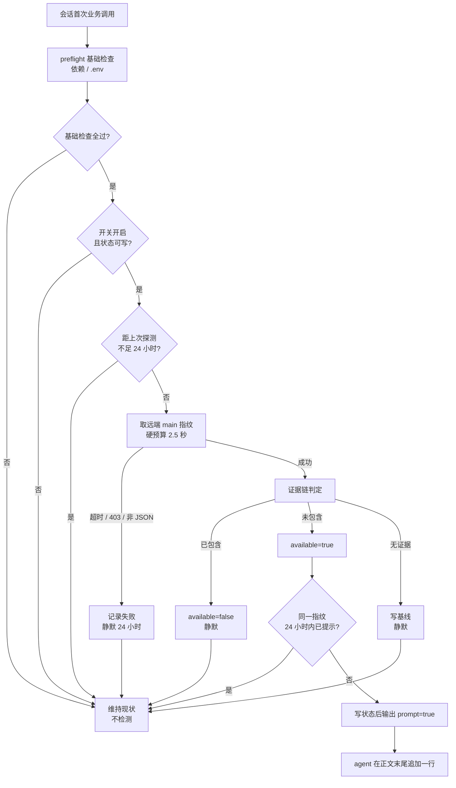
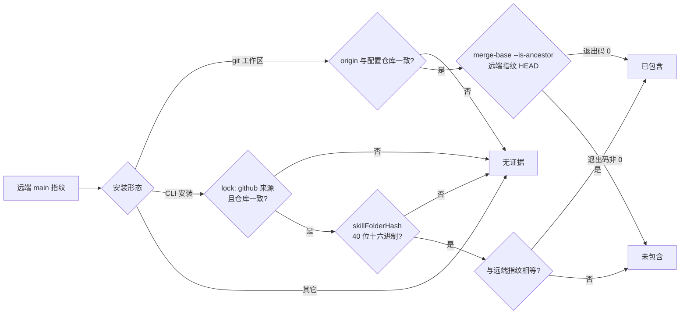
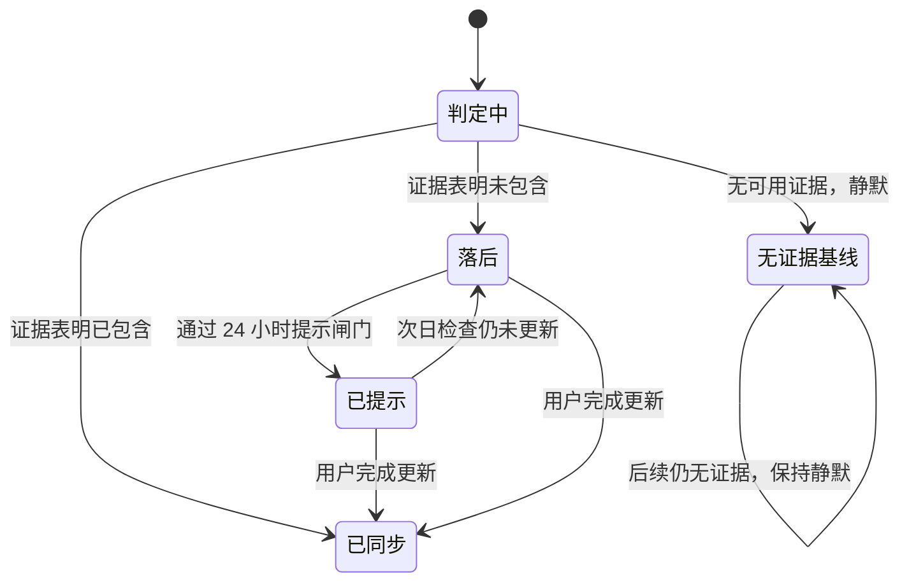

# 技能自动更新检测 - 方案设计

> 日期：2026-11-09　状态：已实现（阶段三完成，待阶段四验收）
> 需求来源：用户提出「我想要一个自动更新技能的功能」，经阶段一需求分析确认
> 本文是**增量方案**（功能尚未实现），实现完成后状态改为「已实现」

## 1. 背景与问题

技能当前的更新链路是**手动且靠人想起**的：

- SKILL.md 路由表有「更新」入口，references/_shared/update-flow.md 定义了完整的执行步骤，但**没有任何环节主动发现"有新版本"**。用户不主动问「有没有更新」，技能就永远不知道自己落后。
- `metadata.version` 停留在 `1.2.0`，而远端已有两个功能提交未 bump 版本号。**版本号不能作为检测判据**，用它比较会漏报。
- 安装形态不同，更新动作也不同：CLI 安装走 `scripts/update.ps1`，克隆/符号链接的开发副本走 `git pull`；而 `update.ps1` 会主动拒绝链接形态（`update.ps1:16-20`）。误判形态会给出错误指令。
- skills CLI 本身提供 `npx skills check`（只读、有更新时退出码 1），但它不在任何业务链路里，且每次都要起 node 进程。

结果：技能的内容更新完全依赖用户偶然得知。

## 2. 需求结论（阶段一已确认）

| 决策点 | 结论 |
|---|---|
| 自动程度 | 检测后**提示**，由用户决定是否执行；不自动更新 |
| 触发时机 | 会话首次业务调用前，随 preflight 一起执行，不新增工具往返 |
| 检测判据 | 远端 `main` 的 commit 指纹，不用版本号 |
| 开发副本 / 符号链接 | 只提示「请自行 git pull」，不代为执行 |
| 提示频率 | 同一远端状态 24 小时内最多提示一次 |
| 开关 | `.env` 中 `IWP_UPDATE_CHECK`，默认 `1` |
| 提示落点 | 回复正文末尾一行，不进 `question`，不打断任务 |
| 生效时机 | 更新在当前会话不生效，新会话生效 |

**效率预算（已确认）**：稳态（当天第 2 次及以后）0 ms；每天首次 ≤2 s；断网等失败场景 ≤2.5 s 且每天最多一次。

## 3. 目标与非目标

**目标**

1. 用户无需记得「检查更新」，每天首次使用时自动发现落后。
2. 发现落后时给出一行可执行、与安装形态匹配的提示。
3. 检测本身不拖慢主流程：稳态零网络、失败不阻塞、不改变 preflight 的成败判定。
4. 不误报：本地领先远端（开发中）、来源不明、无法建立证据时一律沉默。
5. 更新完成后自动回到「已同步」，无需手工清理状态。

**非目标**

1. 不做自动更新、不自动 git pull、不自动调用 `update.ps1`。
2. 不判断"新版本是否兼容"、不读取更新日志、不弹窗。
3. 不检查非 GitHub 来源（本地目录、下载包）的更新。
4. 不替代现有 update 流程，只在其前面增加「发现」环节。
5. 不引入版本号比较；不解决 `CLIENT_VERSION` 与 `metadata.version` 的口径漂移。
6. 不新增 CLI 子命令作为业务前置（诊断入口可有，但不参与主流程）。

## 4. 真实现状（设计与验证依据）

| 事实 | 来源 | 对设计的影响 |
|---|---|---|
| preflight 仅检查依赖可导入性与 `.env` 存在性，输出 `{ok, checks, hints}` | `scripts/preflight.py:108-143` | 天然挂载点：检查项同源、一次进程内完成 |
| `ok` 只由 `checks` 聚合，`hints` 不参与 | `scripts/preflight.py:134-142` | 新增检测结果放独立键，不改判定 |
| 输出为 ASCII-safe JSON，成功 0 / 失败 1 | `SKILL.md:44` | 新增块必须纯 ASCII，中文提示词放文档层 |
| 本机为符号链接安装，`update.ps1` 会硬失败 | `C:\Users\11349\.agents\skills\iwp` → 仓库目录 | 形态判定必须先于建议生成 |
| lock 中 `skillFolderHash` 与远端 main 当前 commit 逐字相同 | `%USERPROFILE%\.agents\.skill-lock.json` | 该字段在 GitHub 来源下可当作**源 commit** 使用 |
| 本地 main 领先远端 2 个提交 | `git log --oneline` | 正是"领先不应提示"的现成回归用例 |
| 探测 2 s 超时严格生效（实测 2008 ms） | 本机实测 | 硬预算可实现 |
| GitHub API 取 main 指纹：冷 1281 ms / 热 421–770 ms | 本机实测 | 每天一次可接受 |
| `git ls-remote` 3.3–3.7 s | 本机实测 | 否决，超预算 |
| raw 取 SKILL.md 462 ms，但只有内容没有提交号 | 本机实测 | 否决，无法与本地做同口径比较 |
| 全库无任何自动更新/自动检查代码 | grep「自动更新 / 自动检查 / auto-update」零命中 | 全新能力，无历史包袱 |

## 5. 逻辑方案

### 5.1 组件与职责

| 角色 | 职责 | 不做什么 |
|---|---|---|
| 钩子（preflight） | 在既有检查之后调用检测器，把结果并入输出 | 不因检测结果改变 `ok`、退出码、`hints` |
| 检测器（独立模块） | 读状态、判时间窗、取远端指纹、跑证据链、写状态、产出 `update` 块 | 不导入 httpx、不拉起 cli.py、不读 `.env` 凭证 |
| 证据链 | 用 git 祖先关系或 lock 提交号回答「本地是否已包含远端」 | 不做模糊推断，无证据就沉默 |
| 状态文件 | 记录上次检查时间、上次提示时间/指纹、最近结论 | 不是缓存，不存远端内容 |
| 文档层（SKILL.md + update-flow） | 定义"看到 `prompt:true` 怎么做"与两种提示文案 | 不承载业务逻辑 |

检测器是**纯标准库、独立可执行**的（唯一内部依赖是仅用 pathlib 的配置解析，与 preflight 同款约束）：既被 preflight 调用，也可单独运行做诊断。二者共用同一份判定逻辑，避免"文档说的"和"实际跑的"两套。

### 5.2 触发与时间窗

- 只在**基础检查全过**（`ok == true`）时检测。依赖缺失或 `.env` 缺失时用户正在走 setup，提示更新只会添乱。
- 读状态文件的 `last_check_at`：距上次探测不足 24 小时 → 立即返回，**不发网络请求**。判定依据是字段而不是文件 mtime——`touch`、复制、云同步都会改写 mtime；每次探测尝试（无论成败）都会推进该字段，语义更稳。
- 只有真的放行时才发起一次 HTTPS 请求，且整个探测有硬预算 2.5 s。
- 状态文件不可写（目录只读）→ 不探测：记录不下来，每次会话都会重复探测，不如直接放弃。

时间窗是"检查窗"，与"提示窗"分离：检查最多 24 h 一次；提示在每次放行的检查里最多一次。

### 5.3 远端指纹

`GET https://api.github.com/repos/{repo}/commits/main`

- 固定主机与路径，`repo` 来自配置且做 `owner/name` 字符校验（防 URL 注入）。
- 匿名访问，不发 token、不读 `.env`；带 `User-Agent` 与 `Accept: application/vnd.github+json`。
- 成功判定：HTTP 200 + JSON 含 `sha`（40 位十六进制）。取 `commit.committer.date` 的日期部分用于诊断展示。
- 失败一律降级：超时、DNS 失败、403/限流、非 200、非 JSON、字段缺失 → 记为失败，**静默 24 h**，不重试、不换端点。
- 匿名限流 60 次/小时/IP，每天 1 次请求远低于上限；共享出口 IP 被限流时同样静默降级。

**为何不用其它方案**

| 备选 | 否决理由 |
|---|---|
| `metadata.version` | 已有两个未 bump 提交 → 必然漏报 |
| `git ls-remote` | 实测 3.3–3.7 s，超预算 |
| raw 拉 SKILL.md 比对内容 | 没有本地同口径基线；且内容变化不等于提交推进 |
| `npx skills check` | 需起 node，秒级；且退出码语义只能回答"有/没有"，拿不到指纹与日期 |

### 5.4 本地是否落后的证据链

判定目标是回答一个问题：**远端 main 的这个提交，本地安装是否已经包含？** 只有两种证据，按安装形态选择。

**形态 A：git 工作区（克隆或符号链接指向克隆）**

1. 取工作区 `origin` 的 `owner/repo`（兼容 `https://` 与 `git@` 两种 remote 写法），与配置仓库比对；不一致（fork、无关仓库）→ **无证据**，沉默。
2. 执行 `git merge-base --is-ancestor <remote_sha> HEAD`：
   - 退出码 `0` → 远端提交在本地历史中 → **已包含**。
   - 退出码非 `0` → 本地历史中不含该提交（含浅克隆取不到对象、历史分叉）→ **未包含**。
3. git 不可用、超时、非仓库 → 无证据。

不需要额外的浅克隆特判：拿不到对象就是本地没有，直接判未包含是安全方向。

**形态 B：CLI 安装（无 `.git`）**

1. 读 `%USERPROFILE%\.agents\.skill-lock.json`，找 `iwp` 条目；`sourceType` 必须是 `github`，`sourceUrl` 的 `owner/repo` 必须与配置仓库一致，否则无证据。
2. `skillFolderHash` 必须是 40 位十六进制；与远端 `sha` 相等 → 已包含，不等 → 未包含。

该字段在 GitHub 来源下记录的是**来源提交**（本机实测与远端 `main` 的 SHA 逐字相同），因此等值比较有意义：相等 → 已包含；不等 → 暂判未包含。

残余风险与取舍：若 skills CLI 未来把该字段改成内容哈希，比较会恒不相等，检测退化为"每天一行误报"。这个代价可接受——`form: cli` 给出的动作 `update_route` 对任何版本都成立，误报只会多一行提示，不会给出错误指令；风险在发布前用真实安装复验，CLI 语义变化后随升级重验。

**无证据时**：只把本次远端指纹写为基线，输出 `available:false`，不提示。基线不参与"是否落后"的判定，只用于诊断与后续对比。

### 5.5 提示闸门与自愈

- 判定为**未包含**才 `available:true`。
- 提示闸门：同一指纹距上次提示 < 24 h → 不提示；指纹变化 → 可立即提示（仍受检查窗约束）。等价于"每天最多一条，且不会因为同一天重复调用而重复出现"。
- **不采用"同一指纹终身只提示一次"**：agent 是否把提示写进回复无法被程序验证，终身去重会把"漏提示"变成永久沉默。宁可第二天再提醒一次，也不依赖不可观测的送达。
- 状态写入成功后才输出 `prompt:true`；写失败则整块省略，保持沉默（避免每次会话重复提示）。
- **自愈**：用户按提示更新后，lock 提交号或 HEAD 前进 → 下次检查判为已包含 → 自动回到已同步，无需手工删状态。状态文件若随更新被整目录替换而丢失，最多多一次探测，结论仍是已同步。

### 5.6 状态文件

位置：技能目录内，与技能同生命周期；加入 `.gitignore`，不进版本库。

字段（全部 ASCII，时间用 UTC ISO 8601）：

| 字段 | 含义 |
|---|---|
| `schema` | 结构版本，当前 1；不认识的版本按不存在处理 |
| `repo` | 生成该状态时使用的仓库，切换仓库即视为过期 |
| `last_check_at` | 上次探测**尝试**的时间（成功或失败都更新）；窗口判定只看它 |
| `last_result` | `synced` / `behind` / `unknown` / `error` |
| `last_error` | 最近一次失败原因（`timeout` / `http_403` / `bad_payload` 等），仅诊断用 |
| `known_remote_sha` | 上次成功看到的远端指纹 |
| `last_notified_sha` / `last_notified_at` | 提示闸门依据 |

写入：临时文件 + 原子替换；并发写最后者胜，不加锁。读取：JSON 解析失败、字段类型不符、`schema` 不认识，或 `repo` 与当前配置不一致 → 当作没有状态文件（等价首次运行，立即重新探测）。

状态文件**不加入** `update.ps1` 的 `$statePatterns`：它只记录检测元数据，丢失无业务损害；加进去反而扩大了更新脚本的恢复面。`$statePatterns` 继续只管凭证与 OAuth 中间产物。

### 5.7 输出契约

仅在**本次真的执行了探测**时，在 preflight 输出中追加一个顶层 `update` 对象：

```json
"update": {
  "checked": true,
  "available": true,
  "form": "cli",
  "remote_sha": "babcad0f6a7465174a61bafb049b8a22fa1b7e20",
  "remote_date": "2026-10-21",
  "action": "update_route",
  "prompt": true
}
```

| 字段 | 取值 | 说明 |
|---|---|---|
| `checked` | 恒 `true` | 该块出现即代表探测过 |
| `available` | 布尔 | 事实：本地未包含远端 |
| `form` | `git` / `cli` | 形态 A / 形态 B |
| `remote_sha` | 40 hex | 远端指纹 |
| `remote_date` | `YYYY-MM-DD` | 便于诊断 |
| `action` | `git_pull` / `update_route` | 与形态强绑定，agent 不得自行改写 |
| `prompt` | 布尔 | **agent 唯一的触发条件** |

约束：

- 未探测（缓存命中、开关关闭、状态不可写、基础检查未过）或探测后状态写入失败 → **整块省略**，输出与现状逐字节一致。
- `ok`、`checks`、`hints`、退出码完全不变。
- 整块 ASCII，不使用中文（`ensure_ascii=True` 会把中文转义，反而难读）。
- 内部异常一律吞掉：不得让检测失败产生 traceback 或改变退出码。

### 5.8 安装形态与身份守卫

| 形态 | 判定 | `form` | `action` |
|---|---|---|---|
| 克隆 / 符号链接指向克隆 | 技能目录解析后存在 `.git` | `git` | `git_pull` |
| CLI 安装 | 无 `.git`，lock 有 iwp 条目 | `cli` | `update_route` |
| 来源不一致 | `origin` 或 lock 的 `owner/repo` ≠ 配置仓库 | — | 沉默 |
| 无法判定 | 两者都不成立 | — | 沉默 |

身份守卫的意义：对 fork 安装，按上游仓库提示"有新提交"会产生噪音，而给出的 `git pull` 又会拉 fork——动作与结论不匹配。宁可不检测，也不给错指令。用户可把 `IWP_UPDATE_REPO` 改指向自己的仓库来恢复检测。

### 5.9 配置面

| 变量 | 默认 | 语义 |
|---|---|---|
| `IWP_UPDATE_CHECK` | `1` | `0` 关闭全部检测（不探测、不提示、不写状态） |
| `IWP_UPDATE_REPO` | `TKOHP/iwp-skill` | 检测目标；改指向自己的 fork 即恢复检测 |

两者读取方式与现有配置一致（`.env`），缺失即用默认值。读取复用技能既有的 `.env` 解析与目录解析（与 preflight 同源，仅依赖 pathlib），不重复实现解析逻辑。**不新增**任何必填配置。

### 5.10 提示文案与落点

文档层按 `form` 二选一，agent 原样追加到**回复正文末尾**，独立一行：

- `form: cli` → 「检测到 iwp 技能有更新（`<sha 前 7 位>`，`<日期>`）。回复「更新 iwp 技能」即可更新，新会话生效。」
- `form: git` → 「检测到上游有新提交（`<sha 前 7 位>`，`<日期>`）。当前是开发副本，请在技能目录执行 `git pull`，新会话生效。」

落点规则：正文最后一段之后；不进 `ask_user_question` 的选项或问题；不打断写操作的预览-确认流程；不改写任务结论。若任务本身就在讨论更新，则由 update-flow 接管，不重复追加。

## 6. 流程图

**总流程**



**证据链**



**状态生命周期**



## 7. 规则清单（逐条可检验）

| 编号 | 规则 |
|---|---|
| R1 | 开关为 `0`、基础检查未过、状态不可写时，不探测、不写状态、不出块 |
| R2 | 距 `last_check_at` 不足 24 h 不探测；判定依据是状态字段（每次尝试都推进），不依赖文件 mtime |
| R3 | 单次探测硬预算 2.5 s；失败一律静默并 24 h 退避（失败也写状态），不重试、不换端点 |
| R4 | 检测不新增工具调用往返，仍在既有 preflight 进程内完成 |
| R5 | `ok`、`checks`、`hints`、退出码只由既有检查决定 |
| R6 | 只有证据明确回答"未包含"时 `available=true`；其余一律 false |
| R7 | git 证据：`merge-base --is-ancestor` 退出 0 = 已包含，非 0 = 未包含 |
| R8 | lock 证据：来源与仓库一致 + 40 hex + 等于远端指纹 → 已包含；不等 → 未包含 |
| R9 | 无证据或身份不匹配 → 只写基线，不声称、不提示 |
| R10 | 同一指纹 24 h 内最多提示一次；指纹变化可再次提示 |
| R11 | 状态写入成功后才 `prompt:true`；写失败整块省略 |
| R12 | 提示一行、正文末尾、不进 question、不改结论、不打断预览流程 |
| R13 | 任何情况下不自动执行更新命令 |
| R14 | 开发副本只给 `git pull` 提示，不代执行 |
| R15 | 不读 `.env` 凭证、不发带认证的请求、只连固定 API 主机 |
| R16 | 检测器纯标准库，不导入 httpx，不依赖 cli.py |
| R17 | 检测内部异常不得产生 traceback、不得改变退出码 |
| R18 | 状态原子写；损坏/未知版本按不存在处理；不进版本库 |
| R19 | 更新后无需手工清理状态，下一次检查自动回到已同步 |
| R20 | 现有手动 update 流程的入口、步骤、文案不被替换，只在其前面加"发现" |

## 8. 效率模型

| 场景 | 网络 | 新增耗时 | 说明 |
|---|---|---|---|
| 会话内第 2 次及以后 | 无 | ≈ 0 ms | 一次状态读取（<1 ms，阈值内直接返回） |
| 每天首次（正常） | 1 次 | 0.5–1.4 s | API 0.42–1.28 s + git 祖先判定 0.11 s + 状态读写 |
| 每天首次（限流/404） | 1 次 | < 0.3 s | 快速失败，静默 24 h |
| 断网 | 1 次（超时） | ≤ 2.5 s | 实测 2 s 超时触发于 2.008 s，留 0.5 s 余量 |
| 更新后首次 | 1 次 | 0.5–1.4 s | 判为已同步，静默 |

结论：最坏情况是"每天第一次会话多等 2.5 秒且不产生任何提示"，正常情况是"多等约 1 秒看到一行提示"。稳态零开销。

## 9. 风险与兼容性

| 风险 | 影响 | 处置 |
|---|---|---|
| GitHub API 不可达或被限流 | 检测失效 | 静默降级，24 h 退避；检测不是业务依赖 |
| DNS 解析不受 socket 超时约束 | 极端情况下线程挂起 | 探测放守护线程 + 硬 join；主进程照常输出并退出 |
| lock 字段语义未来变更 | 恒不相等 → 每天一行误报 | 动作 `update_route` 仍成立，无实际损害；发布前真实安装复验，CLI 变更后重验 |
| agent 忽略 `prompt:true` | 当次没提示 | 次日再提示一次；不依赖送达回执 |
| 用户长期不更新 | 每天一条提示 | 提供开关；README 说明关闭方式 |
| 状态随整目录更新丢失 | 多一次探测 | 结论可自愈，无副作用 |
| 用户手改技能文件 | 指纹仍是旧提交，提示更新 | 视为"内容已偏离"，提示重装反而正确 |
| 旧版 SKILL.md + 新版 preflight | 不认识 `update` 块 | 忽略即可，行为与现状一致 |
| 新版 SKILL.md + 旧版 preflight | 无 `update` 块 | 规则要求"无块不提示"，无异常 |
| 老用户升级路径 | 旧安装没有检测器，不会自动获得该功能 | 需手动更新一次；在 README 与发布说明中写明 |

兼容性：新增输出键对既有消费者是纯增量；不新增必填配置；不改变任何现有退出码；Python 侧零新增依赖。

## 10. 验证口径

**验收清单**

| 编号 | 验收标准 |
|---|---|
| A1 | 同一会话第二次 preflight 无任何网络请求（可用本地桩计数验证） |
| A2 | 正常网络下每天首次新增耗时 ≤ 2 s；断网 ≤ 2.5 s |
| A3 | 超时、403、非 JSON、字段缺失四种失败均静默，且 24 h 内不再探测 |
| A4 | `ok`、`checks`、`hints`、退出码与改动前逐项一致（回归矩阵） |
| A5 | 构造"本地落后"夹具 → `available:true`、`prompt:true`、`action` 与形态匹配 |
| A6 | 真实仓库（领先远端 2 个提交）→ `available:false`，无提示 |
| A7 | 提示恰为一行、位于正文末尾、不出现在 `question` 中 |
| A8 | 24 h 内重复调用不重复提示；指纹变化后可再次提示 |
| A9 | 更新后（lock/HEAD 前进）下次检查自动判为已同步，无需清理状态 |
| A10 | 无证据场景（lock 缺失、origin 不匹配、非 git 非 CLI）全部静默 |
| A11 | 状态文件损坏 / 只读目录不影响 preflight 结果与业务调用 |
| A12 | 无新增第三方依赖；不读取 `.env` 凭证；只请求固定 API 主机 |
| A13 | `IWP_UPDATE_CHECK=0` 时零网络、零写入、零输出块 |
| A14 | 旧版 preflight（无该块）与旧版 SKILL.md（不认识该块）均无异常 |

**测试手段矩阵**

| 层面 | 手段 |
|---|---|
| 单元 | 判定函数、时间窗、提示闸门、JSON 解析容错、状态序列化；时间与时钟注入，不 sleep |
| 集成 | 本地 HTTP 桩覆盖 200 / 403 / 404 / 超时 / 非 JSON / 超大响应；桩地址以函数参数注入，不开放环境变量入口 |
| git 夹具 | 已包含 / 落后 / 分叉 / 对象缺失 / 非仓库 / origin 不匹配，用临时仓库构造 |
| lock 夹具 | 正常、字段缺失、非 40 hex、来源不匹配、仓库不匹配 |
| 状态 | 缺失 / 损坏 / 只读 / 并发写 / 旧 schema |
| 回归 | 现有 preflight 全矩阵（依赖缺失、`.env` 缺失、`--probe` 成功/失败） |
| 手工 | 真实仓库跑一次（期望静默）；临时改状态模拟落后（期望一行提示）；断网跑一次（期望 ≤2.5 s 静默） |

真实网络只做一次性手工确认（GitHub 可达、字段解析正确），不作为自动化用例，避免把外部可用性变成测试的硬依赖。

上述矩阵中的单元 / 集成 / 夹具层面由 `tests/` 下的离线单测落地；该目录是本地开发资产（`.gitignore` 已忽略），不入库、不进发布包。

## 11. 文档角色与后续

| 文档 | 角色 | 本次处理 |
|---|---|---|
| 本文件 | 本功能的增量方案，实现后改「已实现」 | 阶段二产出；阶段三已实现（见 §13） |
| `docs/architecture.md` | 项目当前态与 ADR 汇总 | 实现落地并验证通过后再同步（已确认） |
| 既有 `docs/*-方案设计.md` | 历史增量，均已实现 | 不改 |
| `SKILL.md` / `references/_shared/update-flow.md` / `README.md` | 用户可见契约 | 已按本方案修改（v1.3.0） |

发布标记：该功能上线时 `metadata.version` 升到 `1.3.0`，仅作为发布标识；检测判据始终是 commit 指纹，不看版本号。

## 12. 确认结果（2026-11-09）

| 事项 | 结论 |
|---|---|
| 方案本身 | **认可**（检测判据、证据链、提示闸门、输出契约均通过） |
| 本文档 | **保留**在 `docs/`，作为增量方案长期留存 |
| `docs/architecture.md` | **实现落地并验证通过后再同步**，当前不改，避免文档先于代码 |
| 阶段三（执行实现） | **已完成**（2026-11-09），实现物见 §13 |

后续动作：进入阶段四，按第 10 节 A1–A14 逐项验收。

## 13. 实现落地（阶段三，2026-11-09）

| 实现物 | 说明 |
|---|---|
| `scripts/update_check.py` | 检测器：状态契约与原子写、24h 门禁、匿名远端探测（2.0s 请求超时 + 2.5s 守护线程硬截止）、git/lock 双形态证据、提示闸门、`maybe_check()` 唯一入口（永不抛异常）；含独立只读诊断入口 `python scripts/update_check.py` |
| `scripts/preflight.py` | 在 `ok` 计算与 payload 组装之后追加顶层 `update` 块；不进 `checks`、不改 `ok`/`hints`/退出码；检测异常静默 |
| `.update_state.json` | 运行时状态（`schema`/`repo`/`last_check_at`/`last_result`/`last_error`/`known_remote_sha`/`last_notified_sha`/`last_notified_at`），原子替换，已加入 `.gitignore`，丢失自愈 |
| 测试（本地开发资产） | `tests/test_update_check.py`：58 个离线单元用例（状态契约、判定内核、远端探测、git/lock 证据、编排、preflight 接线），`python -m unittest tests.test_update_check -v`；`.gitignore` 忽略 `tests/`，不入库、发布包不含 |
| 文档层 | `SKILL.md`（版本 1.3.0、第 0 步提示规则、输出契约补充）、`references/_shared/update-flow.md`（自动检测一节）、`README.md`（用户说明 + 版本历史）、`.env.example`（`IWP_UPDATE_CHECK` / `IWP_UPDATE_REPO`） |

实测（本机，2026-11-09）：真实 GitHub 探测 1163 ms；黑洞地址 2012 ms（预算 2.5s 内放弃）；本仓库（开发副本、领先上游 2 个提交）判为 `git` / `synced`、无提示；API 返回 `babcad0`、日期 2026-10-21。
